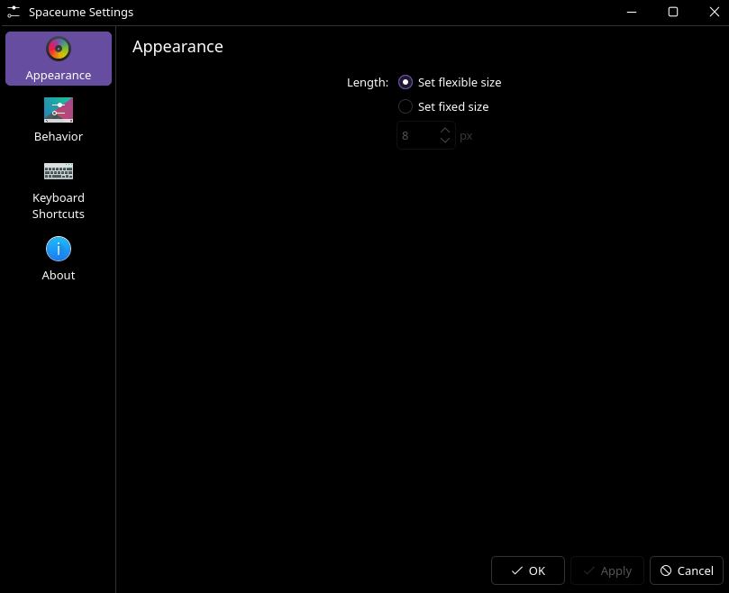
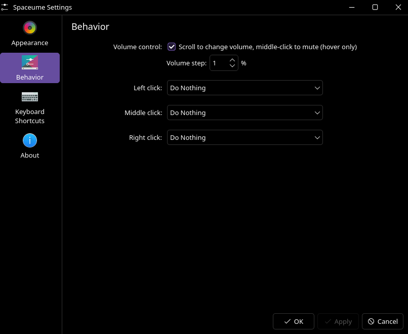

# Spaceume

A Plasma 6 panel spacer that controls system audio volume via scroll wheel and middle-click.

Spaceume adds an expandable spacer to your KDE Plasma panel. When you hover over it, scrolling raises or lowers the volume and middle-click toggles mute. You can also configure left, middle, and right-click actions (Show Desktop, Overview, Grid View, Expose, Run Command, etc.) and run a custom command on click.

Originally based on [plasmoid-spacer-as-pager by eatsu](https://github.com/eatsu/plasmoid-spacer-as-pager). Attribution: [eatsu on KDE Store](https://store.kde.org/u/eatsu) and [plasmoid-spacer-as-pager on GitHub](https://github.com/eatsu/plasmoid-spacer-as-pager).






## Features

- Expandable panel spacer (takes all available space or a fixed length)
- Scroll up/down to raise/lower volume (only when hovered)
- Middle-click to toggle mute (only when hovered)
- Configurable click actions for left, middle, and right mouse buttons
- Optional command execution on click
- Configure via right-click → Configure Spaceume

## Installation

### Option 1: Install from the KDE Store (recommended)

1. Open Plasma's **Add Widgets** dialog.
2. Click **Get New Widgets**.
3. Search for **Spaceume** and install it.

### Option 2: Manual install from this repository

1. Download or clone this repository.
2. Make the install script executable and run it:

   ```bash
   chmod +x install.sh
   ./install.sh
   ```

   This copies the plasmoid to `~/.local/share/plasma/plasmoids/com.github.DoYouKnowMyNamePlz.spaceume/`.

3. Add Spaceume to your panel:
   - Right-click your panel → **Add Widgets**
   - Search for **Spaceume** and add it

### Option 3: Install with kpackagetool6

```bash
kpackagetool6 -t Plasma/Applet -i package/
```

To remove:

```bash
kpackagetool6 -t Plasma/Applet -r com.github.DoYouKnowMyNamePlz.spaceume
```

## Configuration

Right-click the Spaceume spacer on your panel and select **Configure Spaceume** to adjust:

- **Appearance**: expanding mode, fixed length
- **Behavior**: enable volume control, volume step, click actions and commands for left/middle/right clicks

## Requirements

- KDE Plasma 6
- `pactl` (PipeWire/PulseAudio) for volume control
- `dbus-send` and `kglobalaccel` for click shortcut actions

## License

GPL-2.0-or-later. See [LICENSE](LICENSE).

## Attribution

Originally based on [plasmoid-spacer-as-pager](https://github.com/eatsu/plasmoid-spacer-as-pager) by [eatsu](https://store.kde.org/u/eatsu).

Icon by [Josy Dom Alexis](https://pixabay.com/users/josy_dom_alexis-487968/?utm_source=link-attribution&utm_medium=referral&utm_campaign=image&utm_content=1628258) from [Pixabay](https://pixabay.com//?utm_source=link-attribution&utm_medium=referral&utm_campaign=image&utm_content=1628258).
